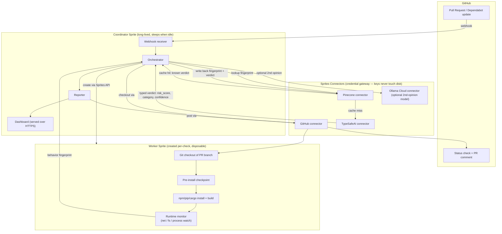
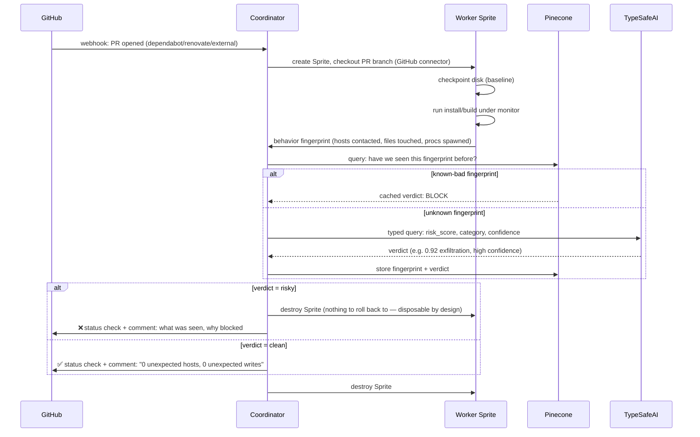
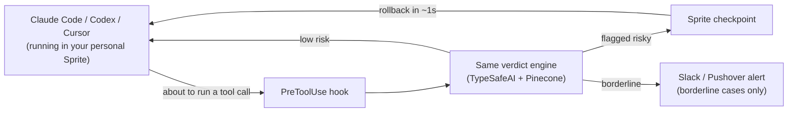
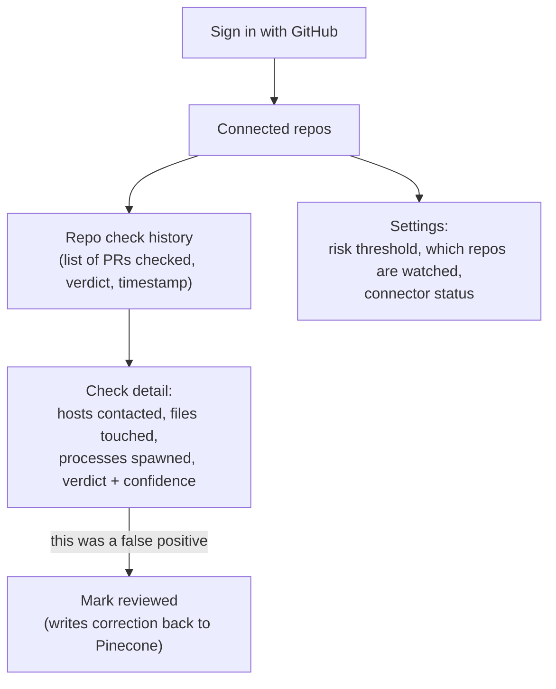

# Architecture

## 1. System overview

Everything runs on Fly.io Sprites. A long-lived **Coordinator Sprite** owns orchestration and state; short-lived **Worker Sprites** do the actual risky execution and get thrown away after.

## 2. Sequence: one PR check, start to finish

## 3. Backend components

| Component | Lives in | Responsibility | Talks to |
|---|---|---|---|
| Webhook receiver | Coordinator Sprite | Verifies GitHub webhook signature, enqueues check | GitHub connector |
| Orchestrator | Coordinator Sprite | Creates/destroys worker Sprites, drives the check lifecycle | Sprites API, all connectors |
| Runtime monitor | Worker Sprite | Snapshots `ss -tupn` (network), filesystem checksums, `ps` tree before/after install; produces a normalized fingerprint | — (local only) |
| Verdict engine | Coordinator Sprite | Pinecone lookup → TypeSafeAI typed call → (optional) Ollama second opinion | TypeSafeAI, Pinecone, Ollama connectors |
| Reporter | Coordinator Sprite | Posts GitHub status + comment, updates dashboard | GitHub connector |
| Dashboard | Coordinator Sprite, served over its own HTTPS endpoint | Recent checks, verdicts, drill-down into what was observed | Reporter (internal) |
| MCP server (stretch) | Coordinator Sprite | Exposes `chaperone.check(pr_url)` as a callable tool for other agents | Orchestrator (internal) |

## 4. Mode B variant (guardrail for your own coding agent)

Here the checkpoint/restore feature carries the whole pitch: it is the undo button for a command the agent already ran.

## 5. UI / UX — dashboard navigation

A minimal dashboard is a stretch goal (Day 5), not the core deliverable — the primary interface is the GitHub PR itself. If built:

The one piece of UX worth getting right for the demo: the **PR comment itself** is the real interface most users will ever see. It should read like a human wrote it — plain pass/fail, plain reasons, no AI-generated hedging.

## 6. Why this isn't just Minder or Cloud Custodian

Both are **policy-declaration** tools — you write rules ahead of time (branch protection, signing requirements, resource tags) and they check configuration against those rules. Chaperone does not require you to predict the rule in advance: it **runs the code and watches what it actually does**, which is the dynamic-analysis gap Socket.dev and Snyk both say they're still building toward. Complementary, not competing — worth saying plainly if a judge asks.
