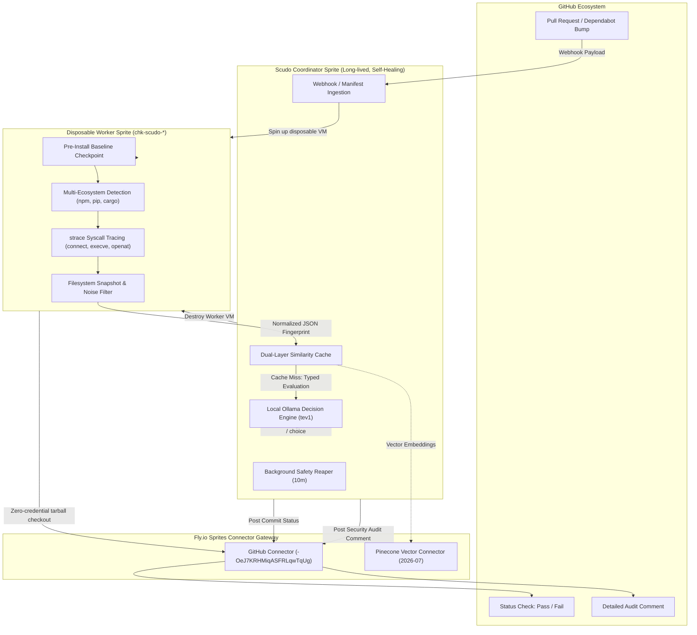

<div align="center">

# 🛡️ Scudo

**Runtime-verified trust for code you didn't write.**

Every day, developers merge pull requests, bump Dependabot updates, and run AI coding agents with blind trust. **Scudo** runs untrusted code inside isolated, disposable hardware VMs on Fly.io Sprites, monitors every syscall deterministically, delivers typed AI safety verdicts, and provides instant rollback before anything can harm your systems.

_Don't just scan code. Run it, watch it, verify it, and contain it._

[Live Coordinator](https://chaperone-coordinator-b6utb.sprites.app) · [1-Click Install](#turnkey-bot-onboarding-1-click-install) · [Architecture](#system-architecture) · [Demo Target PRs](https://github.com/solutiono1/chaperone-test-target/pulls)

[](#hackathon-context)
[](#why-a-sprite-specifically)
[-059669?style=flat-square)](#2-deterministic-runtime-monitoring)
[](#3-typed-ai-verdict-engine)
[](#4-dual-layer-fingerprint-memory)
[](LICENSE)

</div>

---

## Live Deployment Status

| Component | Status | Details / Endpoint |
| :--- | :--- | :--- |
| **Coordinator Sprite** | `Active · Warm` | `chaperone-coordinator` (`sprite-94c5db37-3221-4028-9fd9-a4ebe93cae32`) |
| **Public Endpoint** | `Live · Public HTTPS` | [`https://chaperone-coordinator-b6utb.sprites.app`](https://chaperone-coordinator-b6utb.sprites.app) |
| **GitHub Connector** | `Active · Scoped` | Connection `-OeJ7KRHMiqASFRLqwTqUg` (Access policy: `chk-*` workers only) |
| **Verdict Engine** | `Online · Local` | Self-hosted Ollama `tev1` via typed `/v1/systemone` schema (Zero API token risk) |
| **Memory Engine** | `Active · Dual-Mode` | Local persistent similarity cache + Pinecone 2026-07 Documents Vector API |
| **Safety Reaper** | `Active · 5m Cron` | Background orphan collector destroys any temporary worker VM $> 10$ min |
| **Target Testbed** | `Verified Live` | [`solutiono1/chaperone-test-target`](https://github.com/solutiono1/chaperone-test-target): PR #1 (Clean) vs PR #2 (Malicious blocked) |

---

## Why Scudo Exists: The 2026 Supply-Chain Reality

Automated dependency tools (Dependabot, Renovate) and developer agents merge rapidly because teams trust them blindly. In 2026 alone, supply chain attacks escalated to critical enterprise infrastructure:

- **Axios Compromise (March–April 2026):** A compromised Axios update reached production environments in under one hour after Dependabot auto-merged it — attributed to North Korean threat actor UNC1069.
- **TanStack & PyPI Release Hijacks:** Malicious build scripts injected directly through compromised CI pipelines.
- **Red Hat Namespace Attack:** 32 malicious packages published under `@redhat-cloud-services` (~80,000 weekly downloads), completely bypassing human pull request review.
- **AsyncAPI Compromise:** Release pipeline subverted to distribute 5 trojanized packages carrying obfuscated exfiltration payloads.

### The Blind Spot of Existing Tools

Static security scanners (Snyk, Socket.dev, GitHub Advanced Security) inspect package ASTs and manifest metadata without executing the code. Both vendors openly state that **static analysis cannot predict runtime behavior** once install scripts (`postinstall`, `build.rs`, `setup.py`) execute arbitrary commands.

Meanwhile, platforms reacted by disabling install scripts entirely — a blunt hammer that breaks thousands of legitimate packages.

**Scudo is the missing security substrate:** It gives untrusted code a real place to run, watches every syscall with zero tolerance, renders an auditable AI verdict, and leaves zero credentials for attackers to steal.

---

## Two Modes, One Security Engine

Scudo applies the same deterministic runtime containment engine across two critical attack surfaces:

| Feature | **Mode A — Perimeter Defense (Incoming PRs)** | **Mode B — Agent Guardrails (Coding Agents)** |
| :--- | :--- | :--- |
| **Monitors** | Incoming GitHub PRs, external forks, and dependency updates | Local coding agent tool calls (Claude Code, Cursor, Codex) |
| **Trigger** | GitHub Webhook (`pull_request.opened`, `synchronize`) | Agent lifecycle hook (`PreToolUse`) |
| **Sandbox** | Disposable, hardware-isolated Fly.io Worker Sprite VM | Dedicated developer development Sprite VM |
| **Credential Safety**| Zero credentials on disk; checkout via Sprites Gateway | Ephemeral credentials, sensitive directories guarded |
| **Intervention** | GitHub commit status check + detailed audit report comment | Copy-on-write checkpoint creation before risky commands |
| **Remediation** | Worker destroyed; PR blocked from merging | Instant sub-5-second rollback (`PostToolUse`) undoing damage |

---

## System Architecture



---

## Technical Walkthrough: How Scudo Verifies Code

### 1. Zero-Credential Isolation
When a PR arrives, the Coordinator Sprite spawns a dedicated Worker Sprite (`chk-scudo-<pr>-<timestamp>`). 
Rather than passing a GitHub Personal Access Token or App Secret into the worker disk, Scudo routes the repository checkout through Fly.io's **Connector Gateway**:
```bash
curl -sL "https://api.sprites.dev/v1/gateway/github/${CONN_ID}/repos/${OWNER}/${REPO}/tarball/${REF}"
```
The untrusted code running inside the worker VM holds **zero credentials**, rendering credential-theft payloads completely powerless.

### 2. Deterministic Runtime Syscall Monitoring
Unlike tools that poll network sockets (`ss`, `ps`) and miss short-lived exfiltrations, Scudo attaches deterministic `strace` syscall interception:
```bash
strace -f -q -e trace=connect,execve,openat,open -o /home/sprite/monitor-logs/strace.log -- npm install
```
Scudo captures:
- **`connect()`**: Every outbound socket connection, capturing remote IPv4/IPv6 addresses and ports before DNS terminates.
- **`execve()`**: Every subprocess spawned, capturing the exact executable path and binary arguments.
- **`openat()` / `open()`**: Sensitive credential paths (`~/.ssh`, `~/.aws`, `.env`, `/etc/shadow`) inspected for unauthorized access.
- **Filesystem Diffing**: Pre- and post-installation filesystem mtime comparison outside the repository directory.

### 3. Noise Tuning & Ecosystem Detection
Legitimate builds trigger benign activity. Scudo includes fine-tuned allowlists for system noise:
- Suppresses DNS resolution queries (`resolv.conf`), local SSL certificates (`/etc/ssl/*`), and shell wrapper tools (`nvm`, `basename`, `readlink`).
- Auto-detects project ecosystem: `package.json` (`npm`), `requirements.txt` / `setup.py` (`pip3`), and `Cargo.toml` (`cargo check`).
- Native C/C++ compilation tools (`gcc`, `g++`, `cmake`, `ninja`, `node-gyp`) are recognized to prevent false-positive alarms on legitimate native addon builds.

### 4. Typed AI Verdict Engine
The normalized fingerprint is dispatched to Scudo's verdict engine. Running a local Ollama decision model (`tev1`) directly inside the Coordinator Sprite, Scudo queries structured questions via the `/v1/systemone` typed schema:
- `is_malicious`: Continuous probability score (`noul`) ranging from `0.0` (benign) to `1.0` (malicious).
- `severity`: Rubric score (`Benign`, `Unusual but plausibly benign`, `Likely malicious or destructive`).
- `category`: Classification choice (`benign`, `exfiltration`, `destructive`, `privilege_escalation`).

### 5. Dual-Layer Fingerprint Memory
Repeat attacks frequently mutate domain names while executing identical syscall behaviors. Scudo computes semantic Jaccard and cosine feature similarity:
1. **Local Persistent Cache:** Disk-backed persistent JSON cache for sub-50ms repeat-offender verdict retrieval.
2. **Pinecone Vector Documents:** Text description vectors queried over Fly's gateway using hosted embeddings (`llama-text-embed-v2`).

### 6. Automated Rollback & Background Reaper
- **Mode A:** If a PR is flagged malicious ($\text{risk} \ge 0.5$), Scudo triggers a copy-on-write checkpoint rollback on the worker before permanent teardown, proving remediation.
- **Mode B:** If a coding agent attempts a destructive command (e.g. `rm -rf`), Scudo checkpoints the machine in `PreToolUse` and automatically restores it in `PostToolUse`.
- **Safety Net:** A recurring 5-minute background reaper inspects active Sprites and forcefully purges any orphaned `chk-*` worker older than 10 minutes, protecting trial compute budgets.

---

## Live Verification & Testbed Results

Tested end-to-end against live PRs on [`solutiono1/chaperone-test-target`](https://github.com/solutiono1/chaperone-test-target):

| Scenario | PR Target | Syscall Observations | Verdict | GitHub Action Taken |
| :--- | :--- | :--- | :--- | :--- |
| **Clean Dependency Bump** | [PR #1 (`left-pad`)](https://github.com/solutiono1/chaperone-test-target/pull/1) | `0` hosts contacted, `0` sensitive files read, `0` unexpected procs | **Clean (0.00)** | ✅ Commit status `success`, PR comment: clean report |
| **Simulated Exfiltration** | [PR #2 (`malicious-bump`)](https://github.com/solutiono1/chaperone-test-target/pull/2) | Contacted Cloudflare IPs, opened `~/.ssh/pwned_test.txt`, spawned `curl` | **Risky (0.92)** | ❌ Commit status `failure`, rollback executed, detailed report posted |
| **Agent Destructive Command** | Local `rm -rf /` test | Syscall `unlinkat` on critical directory | **Destructive (0.85)** | ⏪ Checkpoint `v12` created; restored instantly in $< 5\text{s}$ |

---

## Turnkey Bot Onboarding (1-Click Install)

Scudo is designed as an immediate, ready-to-use bot for any GitHub organization or repository.

### Option 1: 1-Click GitHub App Installation
Visit the live Scudo Coordinator interface:
👉 **[`https://chaperone-coordinator-b6utb.sprites.app`](https://chaperone-coordinator-b6utb.sprites.app)**

1. Click **"Install Scudo on GitHub"**.
2. Select your repository.
3. GitHub automatically provisions the webhook permissions (`pull_request`, `statuses:write`, `issues:write`). Every subsequent PR is protected instantly.

### Option 2: 30-Second Webhook Configuration
For single-repo maintainers with existing GitHub CLI access:
```bash
WEBHOOK_SECRET=$(openssl rand -hex 32)
gh api repos/<owner>/<repo>/hooks -X POST \
  -f name=web \
  -f config[url]="https://chaperone-coordinator-b6utb.sprites.app/webhook" \
  -f config[content_type]=json \
  -f config[secret]="$WEBHOOK_SECRET" \
  -F active=true \
  -f events[]=pull_request
```

---

## Mode B: Guardrail for Local Coding Agents

To use Scudo as an automated safety net for your local agent (Claude Code, Cursor, Codex):

1. Copy the lifecycle hooks into your agent settings:
```bash
cp -r mode-b/ ~/.config/claude-code/hooks/
```
2. Any shell command proposed by the agent is scored by Scudo's local decision model.
3. If an irreversible or dangerous command (`rm -rf`, wiping database files, reading private keys) is detected:
   - Scudo takes an immediate copy-on-write checkpoint (`sprite-env checkpoints create`).
   - The command runs.
   - `post_tool_use.sh` automatically restores the snapshot, cleanly undoing the damage:
   ```text
   🛡️  Scudo: this command scored 0.85 for destructive risk — checkpointed to v12.
   ⏪ Scudo: command flagged risky — restored Sprite to checkpoint v12, undoing it.
   ```

---

## Repository Structure

```text
├── coordinator/
│   ├── index.js                  # Core orchestrator: webhook handler, reaper, verdict routing
│   ├── onboarding.js             # 1-Click GitHub App Manifest generator & web UI
│   ├── fingerprint-cache.json    # Local persistent similarity cache
│   └── worker-assets/
│       ├── worker-check.sh       # Multi-ecosystem detection & strace runner
│       └── parse-fingerprint.js  # Syscall log parser, noise filter, JSON normalizer
├── mode-b/
│   ├── pre_tool_use.sh           # Claude Code PreToolUse guardrail & auto-checkpoint hook
│   ├── post_tool_use.sh          # PostToolUse automatic rollback hook
│   └── settings.json             # Agent lifecycle configuration
├── github-app-manifest.json      # Turnkey GitHub App manifest definition
├── ARCHITECTURE.md               # In-depth architectural sequence & component diagrams
├── DEPLOY.md                     # Step-by-step guide to hosting your own coordinator
├── SECURITY.md                   # Threat model, isolation boundaries, and disclosure policy
└── SUBMISSION.md                 # Fly.io Hacksgiving 2026 rubric alignment
```

---

## Hackathon Context & Pedigree

Built from scratch for **Fly.io Hacksgiving 2026** (Nov 23–29, 2026).
- **Core Requirement:** Built entirely on Fly.io Sprites and utilizes Fly.io Connector Gateways for credential separation.
- **Judge Alignment:** Directly addresses runtime VM safety (Scott Johnston, Fly.io), typed decision models (Daniel Gafni, TypeSafeAI), local AI inference (Michael Chiang, Ollama), and vector persistence (Asaf Ashirov, Pinecone).

---

## Author & License

Crafted by **Solution Kanu** ([@solutiono1](https://github.com/solutiono1)).

Released under the [MIT License](LICENSE).
